<div align="center">

<a href="https://relatch.online">
  
</a>

<br />
<br />

<a href="https://nodejs.org"></a>
<a href="https://vercel.com/docs/functions"></a>
<a href="https://clerk.com"></a>
<a href="https://neon.tech"></a>
<a href="https://upstash.com"></a>
<a href="https://www.cloudflare.com/products/turnstile/"></a>
<a href="https://axiom.co"></a>
<a href="https://www.svix.com"></a>

<a href="https://github.com/pausevolve-wq/relatch/commits"></a>


<a href="LICENSE"></a>

<br />
<br />

**[Open the app](https://app.relatch.online)** &nbsp;·&nbsp; [relatch.online](https://relatch.online) &nbsp;·&nbsp; [Architecture](#architecture) &nbsp;·&nbsp; [API](#api-surface) &nbsp;·&nbsp; [Security](#security-model) &nbsp;·&nbsp; [Frontend](https://github.com/pausevolve-wq/Relatch-fe)

</div>

<br />

## What this is

Relatch turns documents into **skills**: structured files that teach an AI agent (Claude, Codex, or any agent that reads skills) how to work the way those documents describe.

This repository is the **server half** of that compiler. The [web app](https://github.com/pausevolve-wq/Relatch-fe) reads documents in the browser and sends their text here. This service decides whether the caller may run, works out what the skill should be, writes it, checks it, and sends it back. It also keeps signed-in users' skill history, runs OCR for scanned PDFs, and handles the free try that works without an account.

It is a small set of **stateless Node.js functions on Vercel**, five runtime dependencies, and no framework. State lives in two places only: **Redis** for anything that must be atomic and short-lived, and **Postgres** for the one thing that must last, your finished skills.

> [!NOTE]
> **What is deliberately not in this README:** routing rules, prompts, template internals, quality thresholds and model choices. They are the product. This page explains how the service is built and how it keeps its promises, not how it thinks.

<br />

## Architecture

<div align="center">
  
</div>

Every compile request moves left to right through five stages, and nothing expensive happens until the cheap checks have passed.

### 1 · Gate

Every endpoint opens the same way, before any work or any spend:

- **Origin lock.** Responses carry `Access-Control-Allow-Origin: https://app.relatch.online`, and preflights are answered explicitly.
- **Identity.** Either a **Clerk session JWT**, verified server side on every call, or a **short-lived signed trial token** for visitors who have not signed up. There is no unauthenticated path to a model.
- **Bot check.** A trial token is only minted after a **Cloudflare Turnstile** challenge passes, and minting itself is rate limited per network.
- **Shape.** Methods are allow-listed per route, bodies are size-capped per endpoint, and inputs are validated before they are used.

### 2 · Ledger

Allowances are enforced **atomically in Redis** (a single scripted step per request, never read-then-write), so two tabs racing each other cannot both slip under the limit.

- Daily and weekly allowances per account, plus a separate, smaller budget for the free try.
- **Skill sets.** Up to three documents sent under one session inside a short window count as **one** skill. Once the user downloads, the set is closed and further documents under that session are refused with `409`.
- **Idempotent claims.** A free-try skill is held briefly and can be claimed by exactly one account, exactly once.
- **Fails closed.** If the ledger cannot be reached the request is refused with `503`, never waved through.

### 3 · Compiler

Five passes, each with a single job:

| Pass | Job |
|---|---|
| **Read** | Normalise the text, repair encoding damage, and bound it to what the chosen output can faithfully use. Long documents are sampled, not truncated blindly. |
| **Plan** | Work out what the skill is *for*: what kind of document this is, who will use the skill, and what it must make an agent do. A structured, fail-open planning step informs the passes after it and never blocks them. |
| **Route** | Choose a **skill shape** from a library of purpose-built templates (general, persona, codebase, finance and domain-specific families) and the target format (Claude, Codex or Agents). The server decides, and client hints are only hints. |
| **Write** | Generate the skill on one of several **model lanes**. Lanes span more than one provider, so one provider's outage or rate limit degrades a request instead of failing it. |
| **Verify** | A **deterministic quality gate** checks structure, required sections and target-format rules, and the work can go back to *Write* when it falls short. Output is sanitised for its target (frontmatter rebuilt, stray preambles removed) before it leaves. |

New behaviour in the compiler ships **dark first**: it runs beside live traffic and is measured, without changing a single response, until the numbers say it has earned the right to.

### 4 · Deliver

The response is the skill Markdown with valid frontmatter, plus the signals the app shows (for example whether a result is degraded). Codex output also carries the metadata needed to produce its `agents/openai.yaml`.

<br />

## API surface

All routes live under `/api` and are called by the Relatch app. They are not a public API: they require the app's origin and an identity on every call.

| Route | Method | Identity | Purpose |
|---|---|---|---|
| `/api/enrich` | `POST` | Clerk or trial token | Compile document text into a skill. The main event. |
| `/api/ocr` | `POST` | Clerk or trial token | Extract text from scanned PDFs, with a page cap, a primary engine and a fallback. |
| `/api/anon-token` | `POST` | Turnstile token | Mint a short-lived signed token for the free try. |
| `/api/claim` | `POST` | Clerk | Unlock a held free-try skill into the signed-in account. |
| `/api/session-complete` | `POST` | Clerk or trial token | Close a skill set once it is downloaded. |
| `/api/usage` | `GET` | Clerk | Skills left today and this week. |
| `/api/skills` · `/api/skills/:id` | `GET` `PUT` `DELETE` | Clerk | The signed-in user's skill history: list, save, rename and delete. |
| `/api/waitlist-check` | `POST` | Clerk | Duplicate-email check for the waitlist. |
| `/api/clerk-webhook` | `POST` | Svix signature | Account lifecycle events from Clerk. |

### Responses

Errors are JSON with a stable machine-readable `error` code and a human `message`. The app maps each code to a specific screen rather than a generic failure.

| Status | Meaning | Example codes |
|:-:|---|---|
| `400` | The request is malformed | `INVALID_JSON`, `INVALID_BODY`, `INVALID_TARGET` |
| `401` | No identity, or an invalid one | `ANON_TOKEN_INVALID` |
| `403` | The bot check did not pass | `TURNSTILE_REQUIRED`, `TURNSTILE_FAILED` |
| `405` | Wrong method for the route | |
| `409` | The work is already done or already taken | `SESSION_COMPLETE`, `CLAIM_TAKEN` |
| `413` | Too large to keep | `SKILL_TOO_LARGE` |
| `422` | The document does not carry enough signal to build a useful skill | `INSUFFICIENT_SIGNAL` |
| `429` | An allowance or rate limit was reached | `QUOTA_REACHED`, `ANON_TOKEN_RATE_LIMITED` |
| `503` | A dependency is unavailable, so the request is refused rather than risked | `QUOTA_UNAVAILABLE`, `ANON_TRIAL_UNAVAILABLE` |

<br />

## Security model

| Concern | How it is handled |
|---|---|
| **Who can call** | Origin lock to `app.relatch.online` · Clerk JWT verified on the server · signed, expiring trial tokens · Turnstile before a trial token exists |
| **Abuse and cost** | Atomic allowances in Redis · per-network minting limits · per-endpoint body caps · bounded OCR pages · a hard 300 s function ceiling |
| **Failure posture** | Quota and trial infrastructure **fail closed** (`503`). Optional enrichment steps fail open, so a planning hiccup never costs a user their skill. |
| **Webhooks** | Verified with Svix over the **raw** request body before anything is parsed or acted on |
| **Database access** | The app connects as a least-privilege role (row access to one table, no DDL). Backups use a separate read-only role. Schema changes are applied by the owner, by hand, from [`db/migrations`](db/migrations). |
| **Secrets** | Server-side environment variables only. Nothing sensitive reaches the browser bundle. |
| **Model output** | Treated as untrusted text: sanitised per target here, and rendered as text nodes (never HTML) in the app |

### Privacy, by construction

The skill-history schema states it in its first lines, and the code follows it:

> Never stored: the source document, its file name, its extracted text.

A history row holds the skill's name, its target, timings, and the generated skill files, capped in size and keyed to the account. **Deleting your account deletes your entire skill history**: the signed account webhook removes every row for that user, and a retried delivery is harmless.

<br />

## Reliability and observability

- **Provider diversity.** Generation and OCR each have more than one provider behind them, chosen by evidence rather than habit, with automatic fallback.
- **Bounded everything.** Input size per output shape, OCR page counts, request bodies and function duration all have explicit ceilings, so the worst case is known in advance.
- **Structured telemetry** on every compile (timings, the route taken, quality outcomes) in Axiom. The heavier quality and routing events are shipped after the response is sent, so they never add latency, and each is time-capped so a slow sink cannot keep a function alive.
- **Dark launches.** Changes to routing and quality checks are measured in shadow against real traffic before they are allowed to change what users receive.
- **Offline regression harness.** Compiler changes are replayed against a fixed document corpus before they merge.

<br />

## Project structure

```text
api/              one file per route (Vercel maps the file name to /api/<name>)
lib/              shared modules: planning, verification, OCR routing,
                  usage limits and the free-try claim store
db/migrations/    the Postgres schema, the source of truth (applied by hand)
test/             node:test suites
vercel.json       per-function time limits, the /skills/:id rewrite, CORS headers
```

<br />

## Deployment

Merges to `main` deploy to Vercel. `main` is protected: every change goes through a pull request with an approving review. `vercel.json` gives the compiler a 300-second ceiling and OCR 60 seconds. Every other route runs on the default, short ceiling.

<br />

### Configuration

Configuration lives only in the Vercel project's environment variables, grouped like this:

| Group | What it needs |
|---|---|
| Identity | Clerk secret key · Clerk webhook signing secret |
| Bot check | Turnstile secret key |
| Generation | API keys for the model providers in use |
| OCR | API keys for the OCR providers in use |
| Storage | Postgres connection string · Upstash Redis REST URL and token |
| Telemetry | Axiom token and dataset (optional: without them telemetry is skipped) |
| Modes | Feature switches for staged rollouts (each defaults to off) |

The exact variable names are kept in the team's private runbook, not here.

### Tests

The suites in [`test/`](test) use `node:test`. The usage-limit suite runs against a real `redis-server`, because the atomic script is the thing being tested.

<br />

## Licence

Copyright © 2026 Manas Harit. **All rights reserved.** Relatch is proprietary software, not open source. This code is public for viewing only. Copying it, running it, hosting or self-hosting it, or reverse engineering it is not permitted. See [LICENSE](LICENSE). The only way to use Relatch is the hosted service at [app.relatch.online](https://app.relatch.online).

<br />

<div align="center">
  <a href="https://relatch.online"></a>
</div>
